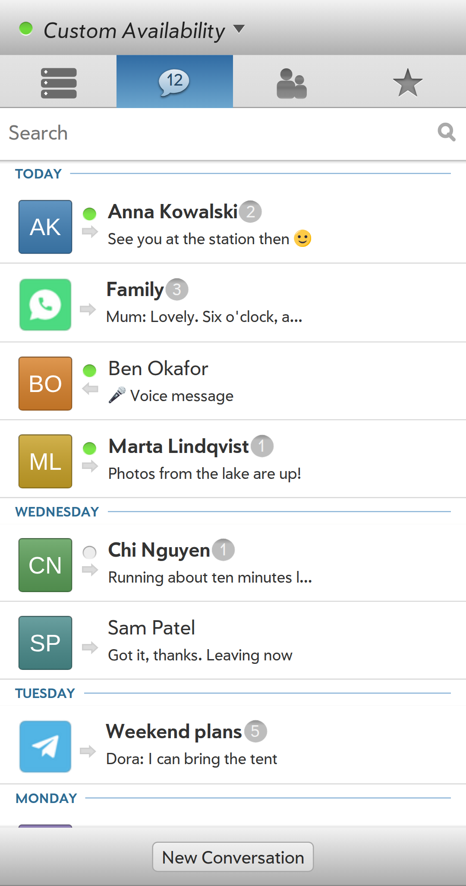
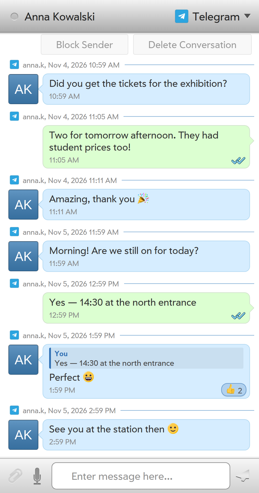
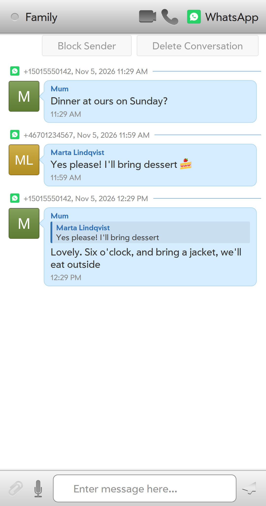
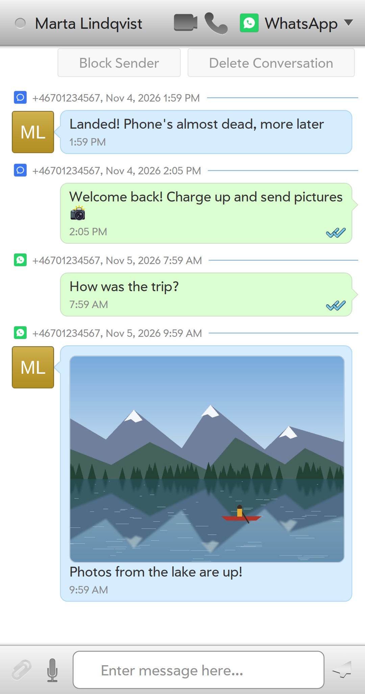
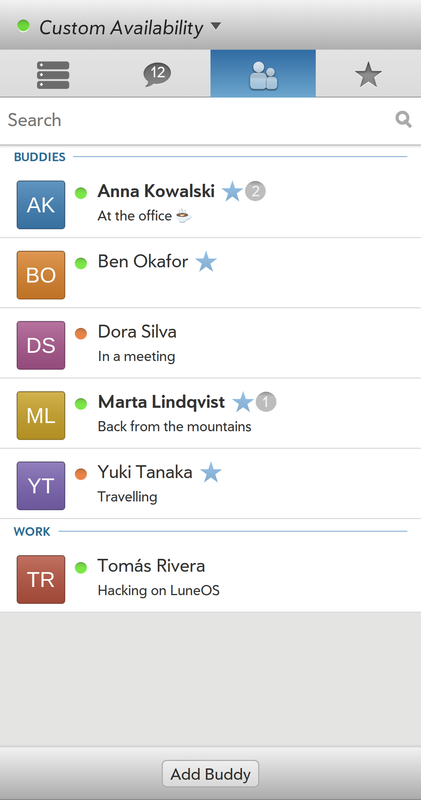
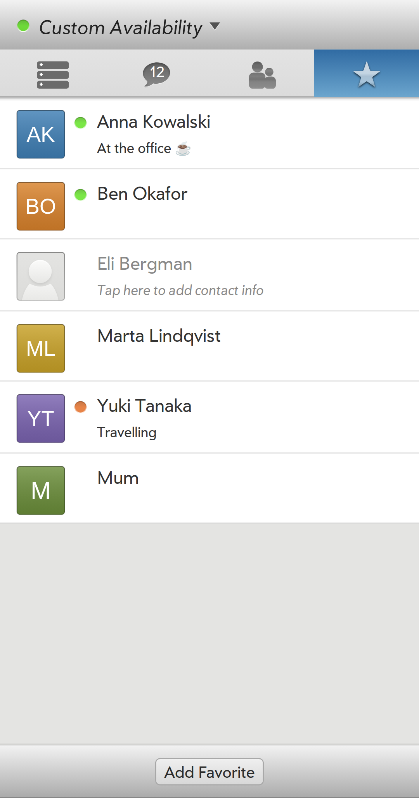
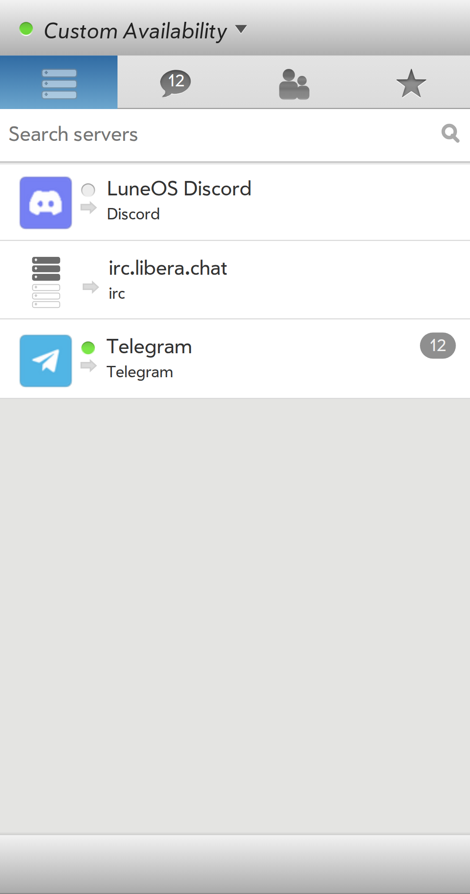
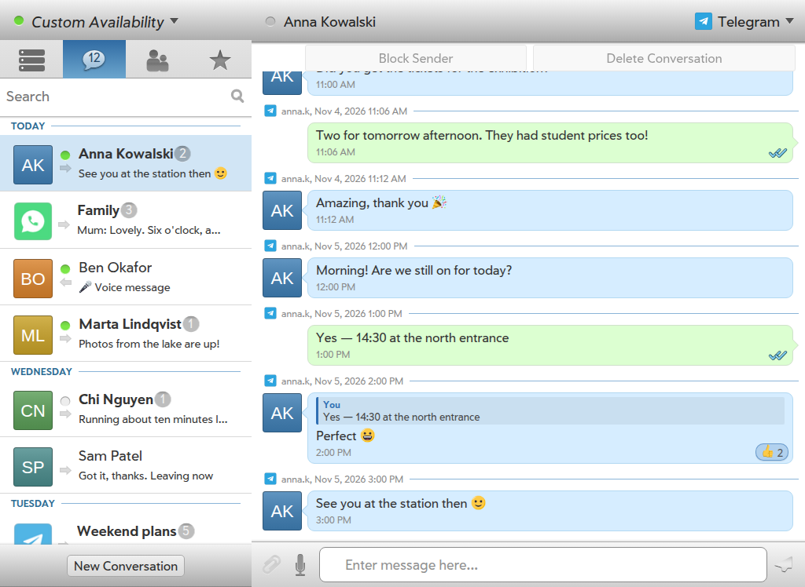
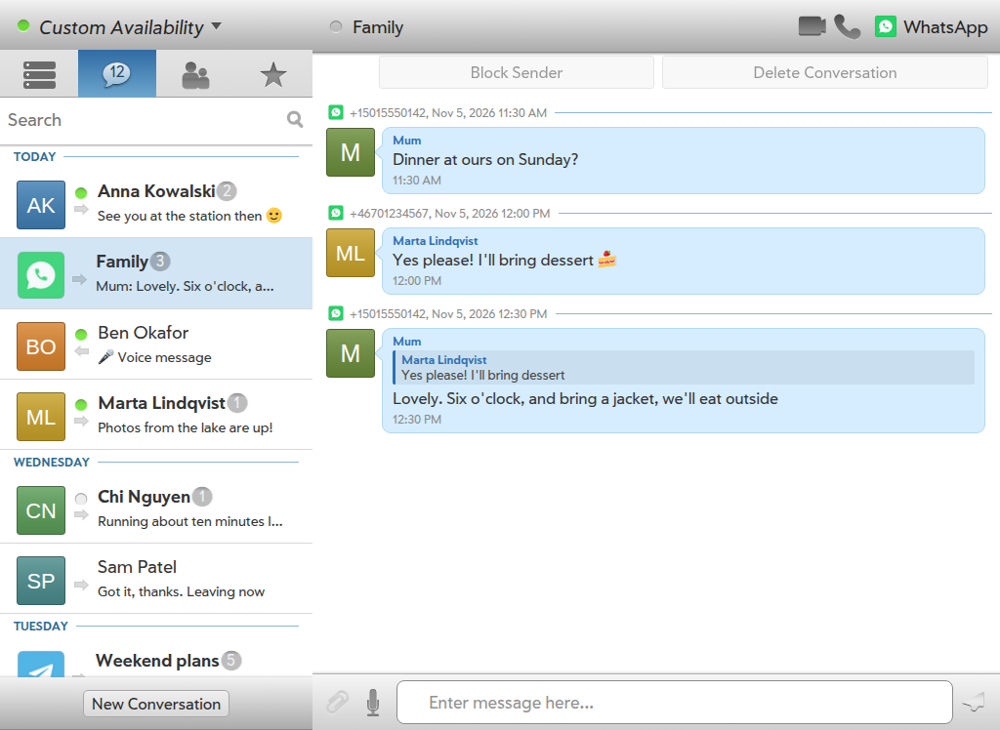
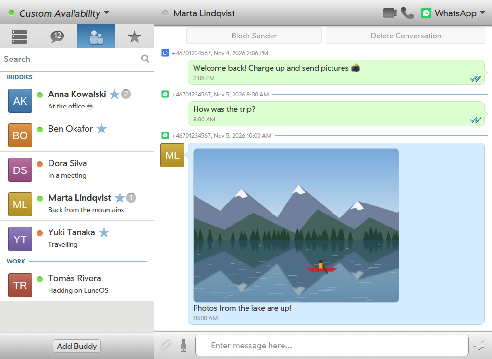

org.webosports.messaging
========================

The Messaging app and service for Lune OS, built with Enyo2 and node.js

Description
-----------
The messaging app is one of the core applications of the operating system and allows you to
send and receive messages through various backend services (IM, SMS, ...).

## Screenshots

Phone (Pixel 3a card, 1080x2050):

<table>
  <tr>
    <td align="center"></td>
    <td align="center"></td>
    <td align="center"></td>
    <td align="center"></td>
  </tr>
  <tr>
    <td align="center">Conversations</td>
    <td align="center">Replies, reactions, read receipts</td>
    <td align="center">Group chat</td>
    <td align="center">Photo</td>
  </tr>
  <tr>
    <td align="center"></td>
    <td align="center"></td>
    <td align="center"></td>
    <td></td>
  </tr>
  <tr>
    <td align="center">Buddies</td>
    <td align="center">Favorites</td>
    <td align="center">Servers and channels</td>
    <td></td>
  </tr>
</table>

Tablet (TouchPad card, 1024x748):

<table>
  <tr>
    <td align="center"></td>
    <td align="center"></td>
  </tr>
  <tr>
    <td align="center">Conversation</td>
    <td align="center">Group chat</td>
  </tr>
  <tr>
    <td align="center" colspan="2"></td>
  </tr>
  <tr>
    <td align="center" colspan="2">Buddies next to a conversation</td>
  </tr>
</table>

The people, chats and pictures are made up: they are the in-browser mock data
(`app/src/data/mockDb.js`, `app/mock`), rendered in headless Chromium with the
Prelude fonts and the service icons of the LuneOS account templates.
`tools/screenshots/shoot.sh` makes them again; see the top of that script for
what it needs.

## Contributing

If you want to contribute you can just start with cloning the repository and make your
contributions. We're using a pull-request based development and utilizing github for the
management of those. All developers must provide their contributions as pull-request and
github and at least one of the core developers needs to approve the pull-request before it
can be merged.

Please refer to http://www.webos-ports.org/wiki/Communications for information about how to
contact the developers of this project.

## Building & Installing App

You can develop in the browser like a normal Enyo 2 web app - 
Messaging will use the data in db8SourceMock.js and the mock directory.
You'll need node.js and enyo-dev: 
http://enyojs.com/docs/latest/developer-guide/getting-started/first-steps.html

After pulling this source code, start a bash shell, `cd` to the app directory, then run
`enyo init`
to pull in the dependencies.

To rebuild on any change (for developing in the browser), run this command once in the app directory:
`enyo pack --watch`

To test in a browswer (Chrome is most like LuneOS) surf to `dist/index.html`

To rebuild and install on a LuneOS device attached via USB, run this command in the app directory:
`enyo pack && adb push dist /usr/palm/applications/org.webosports.app.messaging && adb shell systemctl restart luna-next; adb forward tcp:1122 tcp:1122`
Then, in Chrome, surf to `localhost:1122` to debug.

## API exposed to other apps
Open an `im` or `sms` URL.  Like `mailto` URLs, this does not require a PalmBus call.

`luna-send -n 1 luna://com.palm.applicationManager/open '{"target": "im:fred@aim.com?body=Let%27s%20do%20this%20thing!"}'`

`luna-send -n 1 luna://com.palm.applicationManager/open '{"target": "sms:1-501-555-1212?body=Hey%20babe"}'`

## API exposed to chat threader
When an incoming message arrives, a banner message is displayed.
Tapping on the banner should call (the equivalent of) this:

`luna-send -n 1 luna://com.palm.applicationManager/launch '{"id":"org.webosports.app.messaging", "params": { "threadId": 123456 }}'`